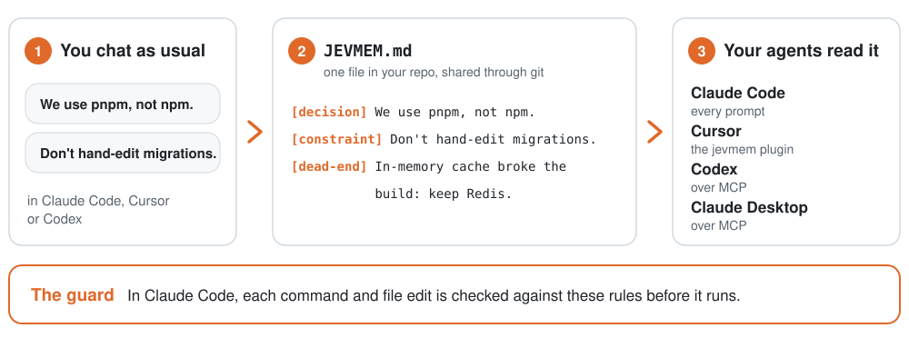
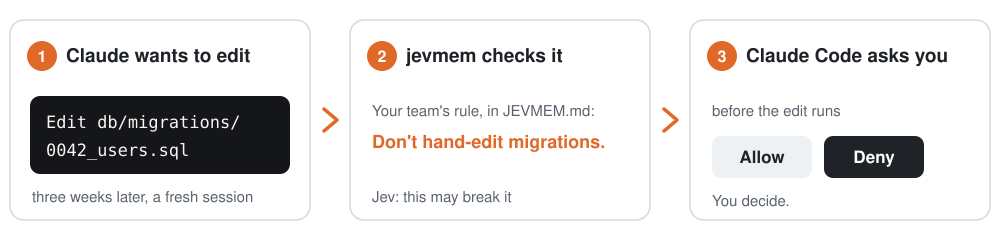
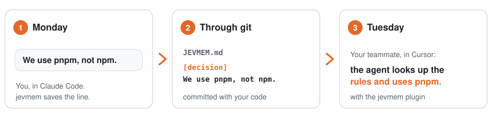
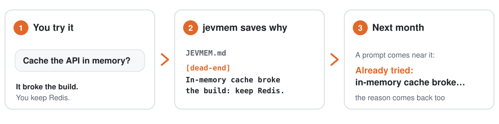
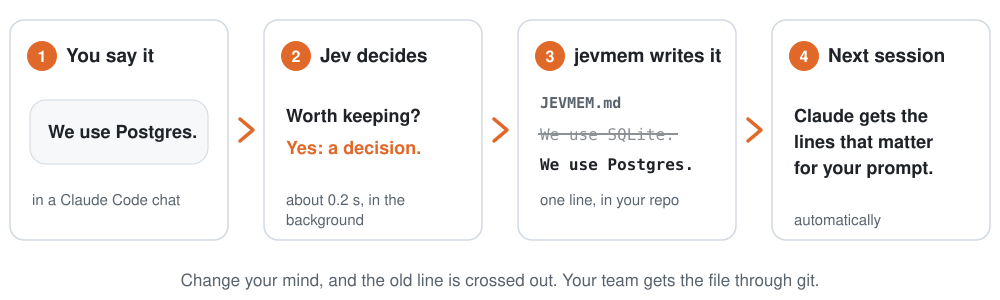
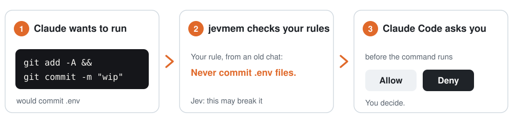
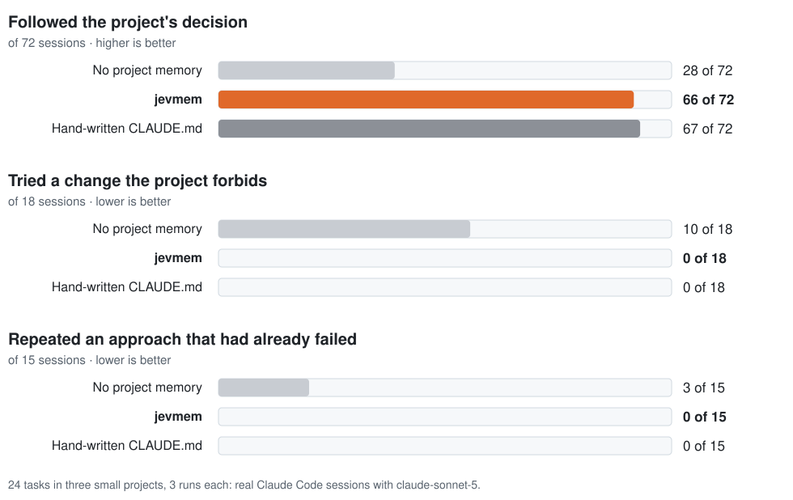
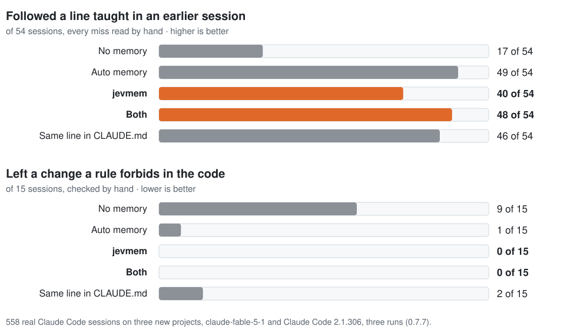
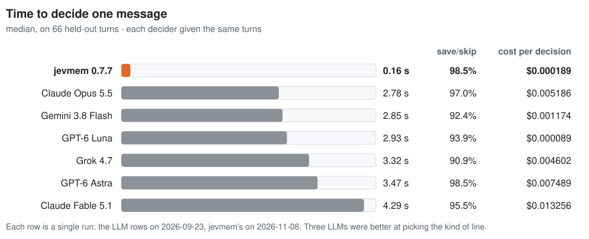
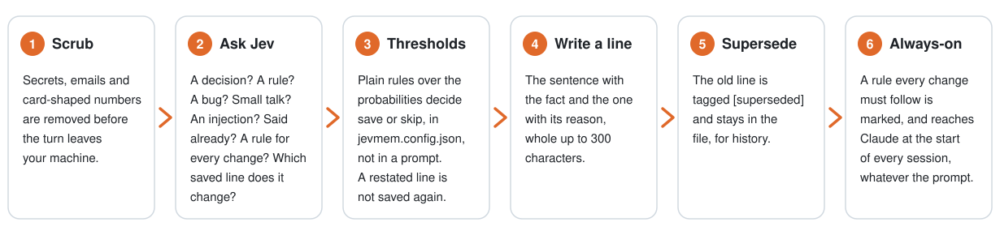

<picture><source media="(prefers-color-scheme: dark)" srcset="https://raw.githubusercontent.com/Avinash-jetwani/jevmem/main/brand/lockup/svg/jevmem-lockup-horizontal-dark.svg"></picture>

**Claude remembers you. jevmem makes your project's rules stick, across your agents and your teammates.** jevmem saves your project's decisions, rules and failed approaches from your chats to one file in your repo, JEVMEM.md, that Claude Code, Cursor and Codex read, and checks Claude's commands against those rules before they run. Your teammates get the same file through git. It works beside Claude Code's own auto memory and adds what that doesn't have: the guard, a shared file in git, and the other tools. It is open source (MIT), built on TypeSafe AI's Jev, in Anthropic's Claude plugin directory and on the MCP Registry, and it works with Claude Desktop over MCP.

You need a paid [TypeSafe API key](https://console.typesafe.ai/keys): your message text is sent to TypeSafe to be scored, with common secrets removed first. No telemetry. Opt-in per project.

In Anthropic's Claude plugin directory · On the [MCP Registry](https://registry.modelcontextprotocol.io/v0/servers?search=io.github.Avinash-jetwani/jevmem) · Open source, MIT

The docs site, one page per question: [avinash-jetwani.github.io/jevmem](https://avinash-jetwani.github.io/jevmem/)

[](https://www.npmjs.com/package/jevmem)
[](LICENSE)
[](package.json)
[](https://github.com/Avinash-jetwani/jevmem/actions/workflows/ci.yml)
[](https://m8ven.ai/mcp/avinash-jetwani/jevmem)

https://github.com/user-attachments/assets/c8a7eced-c427-4ef6-85f2-124eb34ad291

<picture><source media="(prefers-color-scheme: dark)" srcset="https://raw.githubusercontent.com/Avinash-jetwani/jevmem/main/docs/img/rulebook-dark.svg"></picture>

## Three ways teams use it

### 1. The guard: a rule Claude checks before it acts

Your team decided "don't hand-edit db/migrations/: those files are generated". Three weeks later, in a fresh session, Claude is about to edit one. Before the edit runs, jevmem checks it against the rules in JEVMEM.md, and Claude Code stops and asks you first, with the rule:

<picture><source media="(prefers-color-scheme: dark)" srcset="https://raw.githubusercontent.com/Avinash-jetwani/jevmem/main/docs/img/guard-edit-dark.svg"></picture>

```text
jevmem: this may break a saved rule: "Don't hand-edit db/migrations/: those files are generated." (JEVMEM.md)
```

In our tests (0.7.7, checked by hand), a change a rule forbids was left in the code in 0 of 15 sessions with jevmem on. The guard checks Claude's commands, file edits and file writes in Claude Code, and `jevmem trust` lets a rule you wrote block the call instead of asking ([the guard](#the-guard)).

### 2. The team: one file, shared through git

On Monday you tell Claude "we use pnpm, not npm". jevmem saves it as a line in JEVMEM.md, and you commit it with your code. On Tuesday your teammate pulls and opens the repo in Cursor: with the jevmem plugin, the agent looks up the project's rules before a task, and the pnpm line is there, because it travelled with the code through git. Codex reads the same file over MCP when the agent asks, and in Claude Code the guard checks an `npm install` against the rule before it runs.

<picture><source media="(prefers-color-scheme: dark)" srcset="https://raw.githubusercontent.com/Avinash-jetwani/jevmem/main/docs/img/team-dark.svg"></picture>

### 3. No repeated mistakes

You tried caching the API responses in memory, it broke the build, and you kept Redis. jevmem saves that as a failed approach, with the reason. Next month, when a prompt comes near it, Claude gets it back as "Already tried: …" with the reason, and in Cursor and Codex the agent finds it when it looks up the project's memory, so an idea you already ruled out stays ruled out. In our tests, an approach that had already failed was repeated in 0 of 15 sessions with jevmem, against 3 of 15 without.

<picture><source media="(prefers-color-scheme: dark)" srcset="https://raw.githubusercontent.com/Avinash-jetwani/jevmem/main/docs/img/dead-end-dark.svg"></picture>

## Install

You need a [TypeSafe API key](https://console.typesafe.ai/keys), which jevmem's requests are billed to, and Claude Code 2.1.273 or later.

1. In the Claude app: **Plugins → Discover → jevmem → Add**.
2. Install the CLI the plugin runs:
   ```bash
   npm install -g jevmem
   ```
3. In your project's folder, finish the setup in one go (it asks for your key without showing it, turns jevmem on in that folder, and checks the setup):
   ```bash
   jevmem setup
   ```

Start Claude Code in that project. If you start it before the setup is done, the plugin says once what is left; `jevmem doctor` checks the setup any time.

<details><summary>Other ways to install: the jevmem marketplace, npm, Cursor, Codex</summary>

From the jevmem marketplace:

```bash
npm install -g jevmem
claude plugin marketplace add Avinash-jetwani/jevmem
claude plugin install jevmem@jevmem
claude plugin install jevmem-pane@jevmem   # the side pane (0.7.5), optional
cd your-project && jevmem setup
```

With npm only (also sets up Cursor and Codex):

```bash
npm install -g jevmem
cd your-project
jevmem init --tool claude    # or cursor, codex, claude-desktop, all
```

In Cursor, the jevmem plugin (0.7.6) carries the hooks, the MCP server and the rule for every window: install it from the Cursor Marketplace once it is listed there, or copy this repository's `cursor-plugin/` folder to `~/.cursor/plugins/local/jevmem` and reload the window; then `jevmem setup` in each project ([the steps](docs/install.md#the-cursor-plugin-076)). jevmem is also listed on [cursor.directory](https://cursor.directory/plugins/jevmem); its **Add to Cursor** button installs the MCP server alone (recall, with the entry in [docs/mcp.md](docs/mcp.md#cursor)), so saving still needs the plugin folder or `jevmem init --tool cursor`.

Already have a `CLAUDE.md`? `jevmem import` shows what it would add from it; `--apply` writes it.

Every step, and what to do if the plugin can't find the CLI: [docs/install.md](docs/install.md).

</details>

## Beside Claude Code's memory

Claude Code keeps notes of its own, auto memory, on your machine. jevmem runs beside it and adds the parts a team needs:

| | Claude Code's auto memory | jevmem |
|---|---|---|
| Saves from your chats | Yes | Yes: decisions, rules, failed approaches, bugs, to-dos |
| Where it keeps them | Notes on one machine, under `~/.claude/projects/` | `JEVMEM.md` in your repo, shared through git |
| Checks commands and edits against your rules before they run | No | Yes, the guard |
| Works in | Claude Code | Claude Code, Cursor, Codex, Claude Desktop |

Run both: the guard leaves auto memory's own notes alone (0.7.7), and the two side by side, measured, are [below](#next-to-claude-codes-auto-memory-077).

## Why

Each AI coding session starts with a fresh context, and a rule your team agreed lives in one person's chat, on one machine, in one tool.
A `CLAUDE.md` file helps if you keep it up to date. jevmem keeps a file like it up to date for you, as you work, shares it with your team through git, gives it to Claude Code, Cursor and Codex, and checks Claude's commands against it.

## In numbers

In real Claude Code sessions on three small test projects, with jevmem and without it:

- **Tried a change the project forbids:** in 0 of 18 sessions with jevmem, against 10 of 18 without.
- **Claude followed the project's earlier decisions:** in 66 of 72 sessions with jevmem, 28 of 72 without (about 9 in 10, against 4 in 10).
- **Repeated an approach that had already failed:** in 0 of 15, against 3 of 15.
- **Saving:** about 19 cents per 1,000 messages and under a fifth of a second to decide, in the background: Claude doesn't wait for it.
- **Bringing lines back:** about a third to half a second on each prompt, which Claude waits for; the time and the cost grow with the file.
- **Next to Claude Code's own auto memory** (0.7.7, 558 sessions on three new projects): Claude followed a line taught in an earlier session in 47 of 54 sessions with auto memory alone, 40 with jevmem alone and 45 with both; after reading every miss by hand, 49, 40 and 48. With jevmem on, no change a rule forbade was left in the code (0 of 15, checked by hand, against 1 of 15 with auto memory alone). [Details](#next-to-claude-codes-auto-memory-077).
- **To be fair:** a `CLAUDE.md` you keep up to date by hand did about as well (67 of 72), and better on one convention nothing in the prompt points at (3 of 3 against 0 of 3). jevmem keeps a file like it up to date for you, and since 0.7.1 marks such rules always-on, so they reach every session: 18 of 18 on six held-out tasks written for that gap, against 14 of 18 with 0.7.0.

My own test sets, each number from one run; none is an independent benchmark. [Method and results](https://avinash-jetwani.github.io/jevmem/results/)

## How it works

You chat as usual. When you decide something, jevmem writes it as one line in a file in your repo, and brings the right lines back next session.

<picture><source media="(prefers-color-scheme: dark)" srcset="https://raw.githubusercontent.com/Avinash-jetwani/jevmem/main/docs/img/how-it-works-dark.svg"></picture>

1. You decide something in a chat: "We use Postgres."
2. jevmem asks [Jev by TypeSafe AI](https://typesafe.ai), a model that answers yes/no questions with probabilities, whether it's worth keeping.
3. If it is, jevmem writes one line to `JEVMEM.md` in your repo.
4. Next session, the lines that matter for your prompt go back to Claude.

Change your mind, and the old line is crossed out: kept for history, not sent to Claude. Your team gets the same file through git.

jevmem keeps **decisions, rules, bugs, to-dos and dead ends** (an approach that was tried and failed, with the reason).

```text
- [superseded] We'll use SQLite as the primary store for now. → id:cuasaq
- [decision] Switch the primary store to Postgres 16.
- [constraint] Node 20 is the minimum supported version, and CI runs Node 20 and 22.
```

<details><summary>About these lines</summary>

Each line also carries a comment with its id, time and confidence, left out above. The full lines:

```text
- [superseded] We'll use SQLite as the primary store for now. → id:cuasaq  <!-- id:21ycba ts:2026-09-26T13:46:34.703Z conf:1.00 by:cuasaq -->
- [decision] Switch the primary store to Postgres 16.  <!-- id:cuasaq ts:2026-09-26T13:46:35.240Z conf:1.00 -->
- [constraint] Node 20 is the minimum supported version, and CI runs Node 20 and 22.  <!-- id:tollba ts:2026-09-26T13:46:35.763Z conf:0.90 -->
```

Real lines from 0.5.7's default writer, which 0.5.8 to 0.5.10 did not change ([the run](results/readme-example-2026-09-26.txt), 2026-09-26). It kept one sentence of each turn: the Postgres turn also said "SQLite locks up under concurrent writes", and that reason was left out. Since 0.6.0 the line is made from the sentences Jev picks, the one that states the memory and the one that gives its reason ([What's new](docs/whats-new.md)). With `writer` set, an OpenAI or Anthropic model condenses the whole turn instead.

</details>

## The guard

<picture><source media="(prefers-color-scheme: dark)" srcset="https://raw.githubusercontent.com/Avinash-jetwani/jevmem/main/docs/img/guard-dark.svg"></picture>

Before Claude runs a command or edits a file, jevmem checks it against your saved rules. If one might break, Claude Code asks you first:

```text
jevmem: this may break a saved rule: "Never commit .env files" (JEVMEM.md)
```

On a test of 274 tool calls, a set the guard was not tuned on, it caught 66 of 68 rule breaks and asked about 3 or 4 of the 206 calls that broke no rule (one run each on 0.6.0 and 0.6.1).
It's a backstop, not a sandbox: it looks at the words a rule and a call share. Since 0.7.0, `jevmem trust` lets a rule you added by hand block a call in the guard's block mode, not only ask about it. [How the guard works](docs/guardrails.md).

## Works with

Saving is automatic in Claude Code and, since 0.7.4, in Cursor, where Cursor's hooks save each finished agent turn (since 0.7.6 from the jevmem plugin for Cursor, or from the files `jevmem init --tool cursor` writes); and in Codex while `jevmem watch` runs. Cursor, Codex and Claude Desktop reach jevmem over MCP, a standard way for an AI tool to call another program, when the agent asks for it; the Cursor plugin's server runs in every window, while a project's own `.cursor/mcp.json` server starts off until you turn it on once ([the step](docs/mcp.md#cursor)). In Cursor, on 10 held-out chats captured before the code (24 turns), the first run paired 21 of 24 turns whole, the prompt with the whole reply; a reader fix came from that run, and the second run paired 24 of 24, with what to save right in 21 of 24 ([measured](docs/hooks.md#cursor-hooks-074)).

| | Saving | Bringing it back |
|---|---|---|
| **Claude Code** | Automatic, every turn | Automatic, every prompt |
| **Codex** | Automatic while `jevmem watch` runs | When the agent asks, over MCP |
| **Cursor** | Automatic, every finished agent turn (0.7.4; the plugin since 0.7.6) | When the agent asks, over MCP (the plugin's server runs in every window; a project's own server needs one toggle in the Cursor app, [the step](docs/mcp.md#cursor)) |
| **Claude Desktop** | When you ask it to, over MCP | When you ask it to, over MCP |

The MCP server is on the [MCP Registry](https://registry.modelcontextprotocol.io/v0/servers?search=io.github.Avinash-jetwani/jevmem) as `io.github.Avinash-jetwani/jevmem`. Client setup: [docs/mcp.md](docs/mcp.md) · [docs/install.md](docs/install.md#works-with).

## Does it work?

In 72 real Claude Code sessions for each setup, Claude acted on the saved line about as often with jevmem as with the same lines in a hand-written `CLAUDE.md`, and in fewer than half the sessions with neither.

<picture><source media="(prefers-color-scheme: dark)" srcset="https://raw.githubusercontent.com/Avinash-jetwani/jevmem/main/docs/img/results-dark.svg"></picture>

| | No project memory | jevmem | Same lines in `CLAUDE.md` |
|---|---|---|---|
| Followed the project's decision | 28 of 72 | **66 of 72** | 67 of 72 |
| Tried a change the project forbids | 10 of 18 | **0 of 18** | 0 of 18 |
| Repeated an approach that had already failed | 3 of 15 | **0 of 15** | 0 of 15 |

So jevmem did about as well as a hand-written `CLAUDE.md`, without you writing it.
`CLAUDE.md` did better on a convention nothing in the prompt points at (3 of 3 against 0 of 3), measured on 0.6, where jevmem brought a line back only for a prompt it bears on. Since 0.7.1 jevmem marks a rule every change must follow always-on and sends it at the start of every session: on six held-out tasks written for that gap, Claude followed the convention in 14 of 18 sessions with 0.7.0 and 18 of 18 with 0.7.1, as with the same lines in a hand-kept `CLAUDE.md` ([what's new](#whats-new), [limits](docs/limits.md)).
How the sessions were run, and every row: [the benchmark page](docs/benchmark.md#outcome-ab-does-claude-act-on-the-memory).

### Next to Claude Code's auto memory (0.7.7)

<picture><source media="(prefers-color-scheme: dark)" srcset="https://raw.githubusercontent.com/Avinash-jetwani/jevmem/main/docs/img/beside-auto-memory-dark.svg"></picture>

Claude Code keeps notes of its own, auto memory, on by default. To see what jevmem adds next to it, a fact was stated in plain chat in one session, and a later session got a task that needed it, in 558 real Claude Code sessions on three new projects (one model, `claude-fable-5-1`, and Claude Code 2.1.306; three runs of each task).

| Followed the taught line (18 tasks, 3 runs) | No memory | Auto memory | jevmem | Both | Same line in `CLAUDE.md` |
|---|---|---|---|---|---|
| By the checks written before the run | 17 of 54 | 47 of 54 | 40 of 54 | 45 of 54 | 45 of 54 |
| After reading every miss by hand | 17 of 54 | 49 of 54 | 40 of 54 | 48 of 54 | 46 of 54 |
| Left a change a rule forbids in the code (by hand) | 9 of 15 | 1 of 15 | 0 of 15 | 0 of 15 | 2 of 15 |
| Long project, 230 earlier lines (checks → by hand) | 7 → 7 of 18 | 12 → 12 of 17 | 14 → 15 of 18 | 12 → 16 of 18 | 14 → 15 of 18 |

So auto memory on its own followed the taught line more often than jevmem on its own, and with both on Claude did about as well as with auto memory alone; jevmem's guard kept every forbidden change out of the code. On the long project, auto memory's notes ran past the 25 KB Claude Code loads at the start of a session, and jevmem, alone or beside it, did about as well as `CLAUDE.md`.
Reading the 106 misses by hand found 12 that the checks had scored wrong (a number kept in a constant in another file, a year written another way); both rows are shown. In 14 of jevmem's 17 misses its saved line had left out the rule: 9 cut at the line's 200-character limit, which 0.7.7 changes (a line now keeps the sentences that state it up to 300 characters; [what's new](#whats-new)), and 5 where Jev's choice of sentences left out the one with the rule, which 0.7.7 does not change. The comparison ran on the build before that change.
How the sessions were run, the 12 sessions and every row: [the benchmark page](docs/benchmark.md#against-claude-codes-auto-memory-077).

## Side pane

A pane beside your Claude Code chat shows what jevmem just did: the memory lines it gave Claude for your prompt, what its guard said about a command, and the line it saved from the turn, each with `why`, `wrong` and `forget` buttons. The two that change `JEVMEM.md` ask first; a rule is retired in a terminal only. It reads three local files and sends nothing anywhere.

```
/plugin install jevmem-pane@jevmem
```

It is a second plugin from the jevmem marketplace (the jevmem plugin itself still ships no code), for Claude Code 2.1.299 or newer; it opens on its own in a terminal 144 columns wide or wider and in the desktop app's Code tab, and `/jevmem` opens or closes it anywhere. What each block shows, and what was measured: [docs/pane.md](docs/pane.md).

## Fast and cheap

<picture><source media="(prefers-color-scheme: dark)" srcset="https://raw.githubusercontent.com/Avinash-jetwani/jevmem/main/docs/img/benchmark-dark.svg"></picture>

Deciding what to save takes 0.16 s and costs $0.00019 per message, in the background: Claude doesn't wait for it.
On whether to save a message at all, jevmem was right as often as the best of six LLMs (98.5%); three of them were better at naming the kind of line.

Measured on 66 turns written before the code and not tuned on, one run of the 0.7.7 build on 2026-11-08 ([results](results/eval-heldout-2026-11-08-v077.json)); the six LLMs ran on 2026-09-23. All seven in one table, with the cost of each and how it was run: [benchmark](docs/benchmark.md#077-beside-the-six-llms).

## How it decides

<picture><source media="(prefers-color-scheme: dark)" srcset="https://raw.githubusercontent.com/Avinash-jetwani/jevmem/main/docs/img/how-it-decides-dark.svg"></picture>

No prompt decides what to save: Jev answers small yes/no questions with probabilities, and plain rules in code act on them.

<details><summary>Each step in detail</summary>

1. **Scrub.** Common secret shapes, email addresses and card-shaped numbers are removed from the turn before it leaves your machine.
2. **Ask Jev typed questions.** [Jev by TypeSafe AI](https://typesafe.ai) answers a fixed set of small questions with probabilities: is there a decision, a rule, a bug? is it small talk or an injection attempt? does it say the same as a saved line (0.7.0)? is it a rule for how any work in this project is done (0.7.1)? which existing line does it change?
3. **Apply thresholds in code.** Plain rules over those probabilities decide save or skip; they live in `jevmem.config.json`, not in a prompt. A message that restates a saved line is skipped as a duplicate, and one that restates it word for word is skipped before anything is sent (0.7.0).
4. **Write one line.** On save, jevmem writes one line from the sentences of the turn that Jev picks (the one that states the memory and the one that gives its reason), aiming at 200 characters and, since 0.7.7, keeping those sentences whole up to 300 so their rule is not cut off, or, if you set `writer` in `jevmem.config.json`, a small OpenAI or Anthropic model condenses the turn.
5. **Supersede the old line.** If the turn replaces an existing memory, that line is tagged `[superseded] … → id:new` and stays in the file.
6. **Mark it always-on (0.7.1).** A saved rule that Jev reads as one every change must follow gets `always:1` in its comment, and the `SessionStart` hook puts it in front of Claude at the start of every session, whatever the prompt. `jevmem always <id>` marks a line by hand.

Tiers, questions, policy, contradictions, recall and audit: [docs/how-it-works.md](docs/how-it-works.md).

</details>

## Privacy

Your messages go to TypeSafe's API to be scored, with common secrets removed first, and nowhere else unless you set a `writer`.

- jevmem only runs in projects you turn on (`jevmem enable` or `jevmem init`). Elsewhere, nothing is sent.
- Your message, the previous two turns and your memory lines go to TypeSafe's API to be scored, with common secrets scrubbed first. So does Claude's reply on turns that ask a question, report a bug or try something, and, for the guard, the command or the file being changed.
- `jevmem import --from sessions` (0.7.1) sends a project's past Claude Code sessions, turn by turn and scrubbed the same way, only when you run it and answer yes after seeing the count and the cost.
- No telemetry. Nothing goes to OpenAI or Anthropic unless you set `writer` in `jevmem.config.json`.
- Lines a teammate or a pull request adds are checked before Claude sees them.

Exactly what is sent, scrubbed and checked, with the third parties' privacy policies and how to delete your data: [PRIVACY.md](PRIVACY.md). What the check on planted lines does not cover: [SECURITY.md](SECURITY.md).

## Limits

jevmem is young, and these are the limits to know before you rely on it:

- **Early:** first released on 2026-09-22, and every test set was written by the author or captured from Claude Code sessions on scratch projects built for it. None is an independent benchmark.
- **Not the most accurate:** three LLMs scored higher at picking the kind of line. jevmem's edge is speed and cost.
- **Answer quality isn't measured:** the tests check that the right lines reach Claude, not that its answers get better.
- **Use it beside Claude Code's auto memory, not instead of it:** on a line taught in an earlier session, auto memory alone was followed in 47 of 54 sessions and jevmem alone in 40 (0.7.7, one model, three runs). Beside it, jevmem's guard kept every forbidden change out of the code, and on the long project, where auto memory's notes ran past what Claude Code loads, jevmem alone followed the line more often (14 of 18 against 12 of 17 by the checks).
- **Automatic saving is Claude Code and, since 0.7.4, Cursor** (and Codex while `jevmem watch` runs); Claude Desktop saves only when the agent calls `add_memory`, and in Cursor recall is still the agent's call. The Cursor plugin's rule sits in every chat of every project it is installed for, 588 characters of it ([limits](docs/limits.md)).
- **The guard looks at shared words:** a rule worded far from the command it should catch can be missed.
- **The side pane is Claude Code only** (2.1.299 or newer): Cursor has no pane, and Claude Code for VS Code draws none yet.

Every limit, with the numbers: [docs/limits.md](docs/limits.md).

## What's new

What changed, newest first; the measurements behind each line are on the what's new page.

- **0.7.8: the listings lead with what jevmem adds.** The README, the docs site, the npm page, the MCP Registry entry and the plugins' descriptions say first what jevmem adds beside Claude Code's own memory: the guard, one `JEVMEM.md` shared through git, and Claude Code, Cursor and Codex reading it. Wording only; the CLI is as in 0.7.7 ([what's new](docs/whats-new.md)).
- **0.7.7: measured next to Claude Code's auto memory, and a line keeps its rule.** In 558 real sessions, auto memory alone followed a line taught earlier in 47 of 54, jevmem alone in 40 and both in 45 (49, 40 and 48 after reading the misses by hand; [the table](#next-to-claude-codes-auto-memory-077)). The comparison found lines cut at 200 characters before their rule, so a line now keeps the sentences that state it up to 300: on 30 held-out turns the line kept the rule in 24, against 15. An instruction to the agent ("go with option 2, then run the tests") is not saved (on 12 held-out instructions, the first run saved 3 on 0.7.6's code; after the fix, 1), and the guard leaves Claude Code's own memory folder alone ([what's new](docs/whats-new.md)).
- **0.7.5: a pane beside the chat shows what jevmem did.** Install `jevmem-pane` from the jevmem marketplace and Claude Code shows, for each prompt and turn, the lines it recalled, what the guard decided and what was saved, with `why`, `wrong` and `forget` buttons. Also: a leading label like "Decision for this project:" no longer ends up in the saved line (on 12 held-out turns written that way, run once, 0 of 10 lines kept it), `jevmem init --tool cursor` gitignores Cursor's own state folder, `jevmem doctor` says when the Cursor app has not started the project's MCP server, and `jevmem wrong … --should-be none` on a rule asks on a terminal like `forget` does ([what's new](docs/whats-new.md)).
- **0.7.4: a Cursor chat saves like a Claude Code one.** `jevmem init --tool cursor` writes Cursor's hooks (and a launcher, both committable), and when an agent turn finishes the `stop` hook reads the turn from Cursor's transcript and runs the same decide and write path as in Claude Code; reading memory in Cursor stays the agent's MCP call. On 10 held-out Cursor chats (24 turns), captured through Cursor's own CLI before the code, the first run paired 21 of 24 turns whole; a reader fix came from that run, and the second run paired 24 of 24, with what to save right in 21 of 24. Run `jevmem init --tool cursor` once more in a project set up earlier. [Details](docs/whats-new.md).
- **0.7.3: the setup message stays off cloud and Cowork sessions.** 0.7.2's one-time message showed at the start of every claude.ai chat that ran in a cloud workspace, where its marker could not stay. Now it shows only on your own computer (a terminal, the desktop app, the VS Code extension or an SSH session), and a cloud or Cowork session gets no message and no file. The plugin's launcher and the docs; the CLI's code is unchanged. [Details](docs/whats-new.md).
- **0.7.2: finish the setup in one command.** After **Add** in the Claude app, the first session on a machine says once what is left, and `jevmem setup` asks for your key, turns jevmem on in the folder and checks the setup. Always-on lines now go through the poisoning gate before they reach a session, and Jev 1.13.0 is pinned: beside 1.13 on six test sets, 1.14 missed one of five contradictions in all three runs, saved fewer dead ends from captured sessions in all three, and kept fewer of the reasons on the written set. [Details](docs/whats-new.md).
- **0.7.1: rules for every change, and memory from past sessions.** A line marked always-on reaches Claude at the start of every session, whatever the prompt: on six test tasks in files written before their conventions, Claude followed the convention in 14 of 18 sessions with 0.7.0 and 18 of 18 with 0.7.1, as with the same lines in a hand-kept `CLAUDE.md`. `jevmem import --from sessions` reads a project's past Claude Code sessions and proposes the decisions, rules and dead ends in them, after showing the count and the cost and asking. [Details](docs/whats-new.md).
- **0.7.0: fix what it saved.** `jevmem forget` takes an old or wrong line out of use, and `jevmem trust` lets a rule you added by hand block a command, not only ask about it, in the guard's block mode. A line that says the same as a saved one is not saved again: on a test of 25 restatements, 0.6.6 saved 15 as new lines and 0.7.0 saved 1. [Details](docs/whats-new.md).
- **0.6.6: a failed attempt is saved as a dead end, not as a decision.** When you ask Claude to try something and its reply says that failed, jevmem reads the reply: on 40 test turns, 0.6.5 saved 12 as dead ends and 0.6.6 saved 37. The reply is sent on more turns ([PRIVACY.md](PRIVACY.md)). [Details](docs/whats-new.md).
- **0.6.5: a dead end keeps its reason** when Claude's reply gives the verdict first and the cause last. On 13 test turns written that way and handed to the line writer as dead ends, the line kept the reason in 12 (0.6.4: 2 of 13). [Details](docs/whats-new.md).
- **0.6.4: this README, shorter and with graphics;** the details moved to pages in `docs/`. Docs only.
- **0.6.1 to 0.6.3: the guard checks a command with `if [ … ]` in it,** which 0.6.0 let through unchecked, and `jevmem doctor` is clearer. [Details](docs/whats-new.md).
- **0.6: the guard, and dead ends.** Claude Code asks you before a command or edit that may break a saved rule, and an approach that failed is saved with its reason and shown as "Already tried: …" when it comes up again. More of the lines a prompt needs come back, and a turn that hands work to a background subagent is saved once, when it is over. [Details](docs/whats-new.md).

Details and measurements: [docs/whats-new.md](docs/whats-new.md) · Upgrading: [docs/upgrading.md](docs/upgrading.md) · [CHANGELOG](CHANGELOG.md)

<details><summary>Commands</summary>

```text
jevmem init [--tool claude|cursor|codex|claude-desktop|all] [--no-hooks] [--files] [--command "<cmd>"]
jevmem init --remove-hooks                     Remove jevmem's Claude Code hooks and Cursor hooks from this project (plugin users; with the Cursor plugin, its rule and MCP entry too)
jevmem enable                                  Opt this project in (plugin users): jevmem.config.json, JEVMEM.md, .jevmem/
jevmem setup                                   Finish the setup here: the CLI and the plugin, your TypeSafe key (asked for, not shown), jevmem turned on in this folder, doctor; terminal only
jevmem disable                                 Opt this project out: jevmem does nothing here (JEVMEM.md is kept)
jevmem hook                                    Hook entrypoint; reads the Claude Code hook JSON on stdin
jevmem daemon [status|start|stop]              Warm Jev client used by the hook (auto-started, exits when idle)
jevmem watch [--replay] [--once]               Capture turns from Codex's session log for this project (Cursor saves through its hooks)
jevmem mcp [--root <dir>]                      Stdio MCP server
jevmem audit [--dry-run]                       Re-score every memory against the repo, flag [stale?]
jevmem audit --security [--ci]                 List lines that read as instructions to an AI (--ci: exit 1 if any)
jevmem search <query> [--limit N]              Rank memories by relevance
jevmem list [--all]                            Print memories (--all: with superseded and retired lines, and provenance)
jevmem add [--trust] [--always] <kind> <text>  Add a line by hand (secrets scrubbed, a leading tag dropped; no Jev check); --trust marks it verified (asks on a terminal); --always sends it to Claude in every session
jevmem always [--off] <id> [<id>…]             Mark a line always-on (in Claude's context at the start of every session), or take the mark off
jevmem always --suggest [--apply]              Ask Jev which live lines are rules for every change and propose the marks; --apply sets them
jevmem forget <id> [<id>…]                     Retire a line in place: it stays in JEVMEM.md as [retired]; a rule asks for a yes on a terminal
jevmem trust <id> [<id>…]                      Mark a line you wrote as verified, after the poisoning gate (asks on a terminal); the guard can then block on it
jevmem import [--from <sources>] [--apply]     Import CLAUDE.md, AGENTS.md, .cursor/rules/* (claude-auto-memory on request); dry run by default
jevmem import --from sessions [--since 30d] [--apply]   Read this project's past Claude Code sessions; counts and asks before anything is sent
jevmem why <id|hash>                           Every Jev answer behind a line or a skipped turn
jevmem right <id|hash>                         Label a decision as correct
jevmem wrong <id|hash> [--should-be <kind|none>]   Label a decision as wrong (--should-be none retires the line)
jevmem missed "<text>" [--kind <kind>]         Label a turn that should have been saved
jevmem fit [--dry-run] [--force]               Refit weights and thresholds from labels (needs 40+)
jevmem stats                                   Writer, latency p50/p95, cost per day, cache hit rate, escalation rate, retry queue, labels, last fit
jevmem doctor                                  Is this project enabled, where the TypeSafe key comes from, which writer is active and why
jevmem key                                     Save your TypeSafe API key to ~/.jevmem/env (asks for it without showing it)
jevmem log                                     Per-label latency, token and cost summary of .jevmem/log.jsonl
jevmem guard test "<command>" | --edit <path>  Dry run of the PreToolUse guard on one call: rules, prefilter, Jev's answer, hook output
jevmem guard log [-n 20]                       The guard's recent asks and denials in this project, with the rule and score
```

These are 0.7.7's commands: 0.5.10's, `jevmem guard` (0.6.0), `forget`, `trust` and `add --trust` (0.7.0), `always`, `add --always` and `import --from sessions` (0.7.1), `setup` (0.7.2), and `init --files` (0.7.6). Every command accepts `--help`. Set `JEVMEM_VERBOSE=1` for a one-line latency/cost summary after every hook run.

</details>

## Links

- Docs: [how it works](docs/how-it-works.md) · [install](docs/install.md) · [the guard](docs/guardrails.md) · [dead ends](docs/dead-ends.md) · [benchmark](docs/benchmark.md) · [cost](docs/cost.md) · [hooks](docs/hooks.md) · [MCP and client configs](docs/mcp.md) · [configuration](docs/configuration.md) · [limits](docs/limits.md) · [demo](DEMO.md)
- [CHANGELOG](CHANGELOG.md) · [Releases](https://github.com/Avinash-jetwani/jevmem/releases) · [DECISIONS](DECISIONS.md) · [CONTRIBUTING](CONTRIBUTING.md) · [SECURITY](SECURITY.md) · [PRIVACY](PRIVACY.md)
- Built on [Jev by TypeSafe AI](https://typesafe.ai). License: [MIT](LICENSE)
