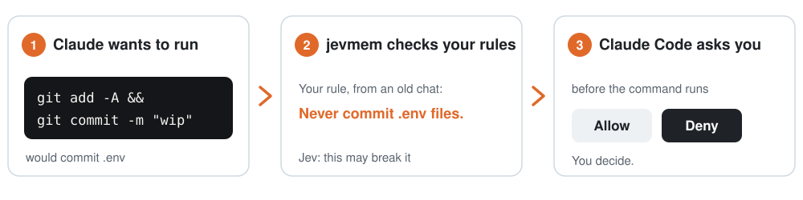

# Can Claude Code check commands against my project's rules before they run?

Yes: with jevmem's guard, before Claude runs a command or edits a file, the call is checked against your saved rules, and if one might break, Claude Code asks you first, or refuses the call in the guard's `block` mode.

On a held-out test of 274 tool calls, the guard caught 66 of 68 rule breaks, with 3–4 false asks in 206 fine calls (run once on jevmem 0.6.0 and once on 0.6.1, on 2026-09-30: [0.6.0](../../results/guard-heldout-v2-2026-09-30.json), [0.6.1](../../results/guard-heldout-v2-2026-09-30-v061.json)). It is a backstop, not a sandbox: it looks at the words a rule and a call share, so a rule worded far from the command it should catch can be missed.

The guard enforces the rules jevmem saved from your chats. A rule added by hand (`jevmem add`, or an edit to the file) can make it ask but not block, since anyone who can change the repository can add such a line. Since 0.7.0, `jevmem trust <id>` (or `jevmem add --trust`) marks a line you wrote as verified, after showing it and asking on a terminal and after the poisoning check, and `block` mode can then refuse a call on it; `jevmem forget <id>` retires a rule, and the guard stops enforcing it. Both are checked end to end in each release ([the 0.7.0 gate](../../docs/benchmark.md#end-to-end-on-the-build-070)).

<picture><source media="(prefers-color-scheme: dark)" srcset="../../docs/img/guard-dark.svg"></picture>

What Claude Code shows you when a call may break a rule:

```text
jevmem: this may break a saved rule: "Never commit .env files" (JEVMEM.md)
```

The guard comes with jevmem 0.6.0 or later: [install](install.md). The rest of this page is the repository's [docs/guardrails.md](https://github.com/Avinash-jetwani/jevmem/blob/main/docs/guardrails.md).

{{include docs/guardrails.md}}
